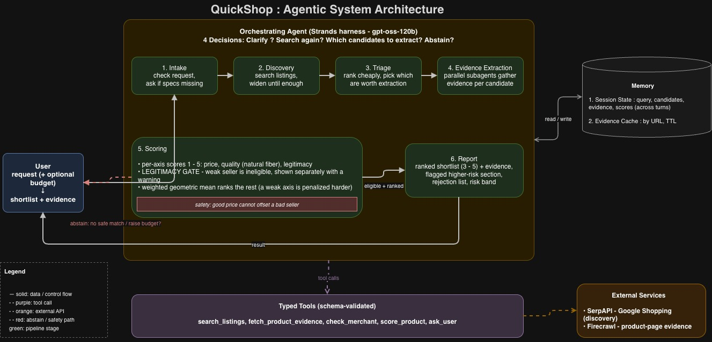

# QuickShop

An agentic AI shopping assistant for clothing. Given a natural-language request, QuickShop
searches across retailers, gathers evidence on each candidate, and returns a short ranked
shortlist scored on three axes : **price**, **quality** (natural-fiber content), and **seller
legitimacy** : with the evidence behind every recommendation.

## Architecture

QuickShop is built as a single **orchestrating agent** (Strands harness, `gpt-oss-120b` via the
ASU Research Computing gateway) with a small set of typed tools and deterministic scoring. The
agent's job is not just to answer, but to decide *how* to answer : which is what makes the task
agentic rather than a single model call or a fixed pipeline.

### The agent's four decisions (its "agency")

1. **Clarify?** : Is the request specified well enough to search, or should it ask the user a
   question first (and which question yields the most for the fewest asks)?
2. **Search again?** : Are there enough good candidates, or should it widen/reword and search
   again? The agent decides when to stop looking.
3. **Which candidates to extract?** : Deep extraction costs API credits, so it picks only the
   candidates worth paying to investigate under the remaining budget.
4. **Abstain?** : Can it answer honestly, or is the correct response "no safe match" / "nothing
   in budget : raise it?" Choosing *not* to recommend is a first-class safety decision.

### Pipeline (input → output)

| Stage | What happens |
|-------|--------------|
| **1. Intake** | Check the request against required specs; ask clarifying questions if anything is missing. |
| **2. Discovery** | Call `search_listings` one or more times, widening until the candidate pool is sufficient. |
| **3. Triage** | Rank the pool on cheap listing-level signals; select which candidates justify expensive extraction under the budget. |
| **4. Evidence Extraction** | Parallel subagents (one per candidate, each from a fresh baseline) gather evidence via `fetch_product_evidence` and `check_merchant`. |
| **5. Scoring** | Deterministic Python scores each axis 1–5, applies the legitimacy gate, then ranks eligible candidates with a weighted geometric mean. |
| **6. Report** | Render the ranked shortlist (3–5) with evidence, a flagged higher-risk section, the rejection list, and a risk band. |

### Scoring (the key design decision)

The LLM **extracts** evidence into a schema but does **not** compute the scores : scoring is
deterministic Python over that evidence, so results are reproducible and auditable.

- **Per-axis scores (1–5):** price · quality (natural-fiber percentage) · legitimacy.
- **Legitimacy gate:** any candidate below the trust threshold is ineligible regardless of price
  or quality, and is shown separately with a warning. *A good price cannot offset a bad seller.*
- **Weighted geometric mean:** ranks the eligible candidates, penalizing a weak axis harder than
  a plain average would.

This replaces the baseline's arithmetic averaging, under which a cheap, nice-looking item from an
untrustworthy seller could still reach the shortlist.

### Memory

- **Session State** : clarified query, candidates, evidence, and scores across turns, so a
  follow-up like "anything cheaper?" re-ranks the existing pool instead of restarting.
- **Evidence Cache** : validated records keyed by URL with a freshness TTL. Replaces the manual
  `products.json` of the baseline and makes evaluation reproducible.

### Typed tools

All tools return schema-validated results and can report an explicit `unavailable` state instead
of guessing.

| Tool | Returns | Source |
|------|---------|--------|
| `search_listings` | candidate listings | SerpAPI |
| `fetch_product_evidence` | evidence record (composition, origin, policy, reviews) | Firecrawl |
| `check_merchant` | merchant signals (domain age, reviews, allowlist) | SerpAPI, public records |
| `score_product` | per-axis scores | deterministic Python |
| `ask_user` | clarification answers | user |

### External services

- **SerpAPI** : Google Shopping endpoint for discovery.
- **Firecrawl** : schema-constrained JSON extracted from a product page for evidence.
