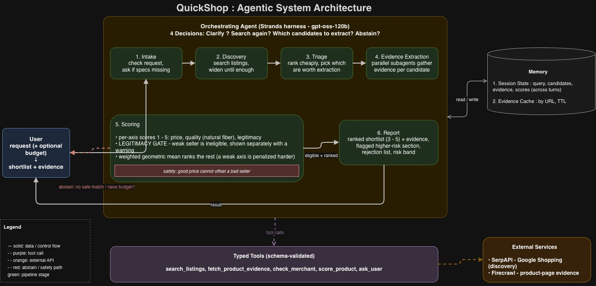

# QuickShop

An agentic AI shopping assistant for clothing. Given a natural-language request, QuickShop
searches across retailers, gathers evidence on each candidate, and returns a short ranked
shortlist scored on three axes : **price**, **quality** (natural-fiber content), and **seller
legitimacy** : with the evidence behind every recommendation.

## Architecture



QuickShop is built as a single **orchestrating agent** (Strands harness, `gpt-oss-120b` via the
ASU Research Computing gateway) with a small set of typed tools and deterministic scoring. The
agent's job is not just to answer, but to decide *how* to answer : which is what makes the task
agentic rather than a single model call or a fixed pipeline.

### The agent's four decisions (its "agency")

1. **Clarify?** : Is the request specified well enough to search, or should it ask the user a
   question first (and which question yields the most for the fewest asks)?
2. **Search again?** : Are there enough good candidates, or should it widen/reword and search
   again? The agent decides when to stop looking.
3. **Which candidates to extract?** : Deep extraction costs API credits, so it picks only the
   candidates worth paying to investigate under the remaining budget.
4. **Abstain?** : Can it answer honestly, or is the correct response "no safe match" / "nothing
   in budget : raise it?" Choosing *not* to recommend is a first-class safety decision.

### Pipeline (input → output)

| Stage | What happens |
|-------|--------------|
| **1. Intake** | Check the request against required specs; ask clarifying questions if anything is missing. |
| **2. Discovery** | Call `search_listings` one or more times, widening until the candidate pool is sufficient. |
| **3. Triage** | Rank the pool on cheap listing-level signals; select which candidates justify expensive extraction under the budget. |
| **4. Evidence Extraction** | Parallel subagents (one per candidate, each from a fresh baseline) gather evidence via `fetch_product_evidence` and `check_merchant`. |
| **5. Scoring** | Deterministic Python scores each axis 1–5, applies the legitimacy gate, then ranks eligible candidates with a weighted geometric mean. |
| **6. Report** | Render the ranked shortlist (3–5) with evidence, a flagged higher-risk section, the rejection list, and a risk band. |

### Scoring (the key design decision)

The LLM **extracts** evidence into a schema but does **not** compute the scores : scoring is
deterministic Python over that evidence, so results are reproducible and auditable.

- **Per-axis scores (1–5):** price · quality (natural-fiber percentage) · legitimacy.
- **Legitimacy gate:** any candidate below the trust threshold is ineligible regardless of price
  or quality, and is shown separately with a warning. *A good price cannot offset a bad seller.*
- **Weighted geometric mean:** ranks the eligible candidates, penalizing a weak axis harder than
  a plain average would.

This replaces the baseline's arithmetic averaging, under which a cheap, nice-looking item from an
untrustworthy seller could still reach the shortlist.

### Memory

- **Session State** : clarified query, candidates, evidence, and scores across turns, so a
  follow-up like "anything cheaper?" re-ranks the existing pool instead of restarting.
- **Evidence Cache** : validated records keyed by URL with a freshness TTL. Replaces the manual
  `products.json` of the baseline and makes evaluation reproducible.

### Typed tools

All tools return schema-validated results and can report an explicit `unavailable` state instead
of guessing.

| Tool | Returns | Source |
|------|---------|--------|
| `search_listings` | candidate listings | SerpAPI |
| `fetch_product_evidence` | evidence record (composition, origin, policy, reviews) | Firecrawl |
| `check_merchant` | merchant signals (domain age, reviews, allowlist) | SerpAPI, public records |
| `score_product` | per-axis scores | deterministic Python |
| `ask_user` | clarification answers | user |

### External services

- **SerpAPI** : Google Shopping endpoint for discovery.
- **Firecrawl** : schema-constrained JSON extracted from a product page for evidence.

## Product evidence (`fetch_product_evidence`)

Given a product URL, `quickshop/evidence/` returns one validated `EvidenceRecord`. It does no search,
no merchant checks and no 1 to 5 scoring: it only reads a page and reports what it found.

```
URL -> canonicalize -> cache (per-field TTL) -> Firecrawl (JSON extraction + markdown)
    -> deterministic fabric parser -> EvidenceRecord -> cache -> dict
```

| File | Job |
|------|-----|
| `schema.py` | `EvidenceRecord` and its parts. Unknown is `None`, never 0. Percentages 0 to 100, currency is a code. |
| `firecrawl_client.py` | The only file that talks to Firecrawl. Never raises; failures become `status="unavailable"` with a reason. Exposes a calls/credits counter. |
| `fabric.py` + `fiber_config.py` | Pure-Python composition parser. Fiber names, categories and part labels live in `fiber_config.py` as data. |
| `cache.py` | SQLite cache keyed by canonical URL. `canonicalize_url()` lives here. |
| `service.py` | The pipeline (`EvidenceService`). `build_record()` is pure and testable. |
| `tool.py` | The Strands `@tool` the agent sees. Always returns a dict that validates against the schema. |

**The model extracts, Python parses.** Firecrawl copies the composition text verbatim. Python turns it
into fibers and percentages and computes `natural_fiber_pct` for the **main fabric only** (shell/body,
or the only part given). Lining, trim and filling are kept but never counted. If the extracted text
is not on the page, it is discarded rather than trusted.

**Status:** `ok` means composition was read unambiguously and a price was found. `partial` means
something is missing or ambiguous (see `error_reason` and `parse_notes`). `unavailable` means the page
could not be read. `composition_confidence` is `explicit`, `ambiguous` (e.g. percentages do not total
100, "approx.", ranges, several unlabeled fabrics; never rescaled) or `missing`.

**Config flags**

| Flag | Where | Default |
|------|-------|---------|
| `COUNT_REGENERATED_AS_NATURAL` (viscose/rayon, modal, lyocell, cupro...) | `fiber_config.py` | `False`. Always reported separately as `regenerated_fiber_pct`. |
| `SUM_TOLERANCE` for "totals about 100" | `fiber_config.py` | `1.0` |
| `FIELD_GROUPS`, `TTLS`, `NEGATIVE_TTL` | `cache.py` | composition/origin/brand 30 days, reviews 7 days, price/stock 6 hours, failures 15 minutes |
| `FIRECRAWL_API_KEY` | `.env` | empty. Without it the tool returns `unavailable`, it does not crash. |
| `QUICKSHOP_EVIDENCE_CACHE` | `.env` | `.cache/evidence.sqlite3` |
| `QUICKSHOP_EVIDENCE_REPLAY=1` | `.env` | off. Serve only from the cache, never call Firecrawl (reproducible evaluation). |

**Cost.** A fresh page read is about 5 Firecrawl credits (1 + 4 for JSON extraction). Cached reads are
free. For the budget hook, `quickshop.evidence.tool.get_usage()` returns Firecrawl calls and credits
plus cache hits and misses. The cache can be frozen with `EvidenceCache.export_json()`.

**Tests:** `pytest` runs everything offline from saved page fixtures in `tests/evidence/fixtures/`.
The one live test is skipped unless you run
`FIRECRAWL_API_KEY=... QUICKSHOP_LIVE_URL=<product url> pytest --run-live`.
